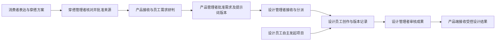

# 永嘉鞋服 CMS · 三 Agent 协作平台

个性化穿搭、产品管理、鞋服设计三个独立产品，贯通消费者表达、需求研判、人工批准、设计创作与结果回传。

**[打开产品导航与当前业务流程](https://leo-ai-pm.github.io/apparel-cms/portal/)** · **[云端导航](https://s357brv8j8f9gdhvbu9a9.apigateway-cn-beijing.volceapi.com/v2/portal)** · [原 CMS 完整流程图（历史构想）](https://leo-ai-pm.github.io/apparel-cms/)

## 直接体验

当前为临时免登录的合成数据演示。进入页面后使用标明的演示身份；批准和发送仍需要主动操作。模型生成受服务端额度与可用性约束。

| 产品 | 使用角色 | 页面入口 | 源码 |
|---|---|---|---|
| 个性化穿搭 Agent | 消费者：自然语言搭配、换搭与个人效果 | [消费者页面](https://s357brv8j8f9gdhvbu9a9.apigateway-cn-beijing.volceapi.com/v2/styling) | [products/styling](products/styling) |
| 个性化穿搭 Agent | 管理者：需求热度、来源审核与交接 | [穿搭管理后台](https://s357brv8j8f9gdhvbu9a9.apigateway-cn-beijing.volceapi.com/v2/styling/admin) | [启动说明](products/styling/README.md) |
| 产品管理 Agent | 员工：处理分派任务与需求研判 | [员工工作区](https://s357brv8j8f9gdhvbu9a9.apigateway-cn-beijing.volceapi.com/v2/product/demo/staff) | [products/product](products/product) |
| 产品管理 Agent | 管理者：复核证据、批准需求并交接设计 | [产品管理后台](https://s357brv8j8f9gdhvbu9a9.apigateway-cn-beijing.volceapi.com/v2/product/demo/manager) | [启动说明](products/product/README.md) |
| 鞋服设计 Agent | 设计员工：自主创作、项目画布与 Agent 对话 | [设计工作区](https://s357brv8j8f9gdhvbu9a9.apigateway-cn-beijing.volceapi.com/v2/design/demo/designer) | [products/design](products/design) |
| 鞋服设计 Agent | 管理者：需求接收、分派、成果审核与回传 | [设计管理后台](https://s357brv8j8f9gdhvbu9a9.apigateway-cn-beijing.volceapi.com/v2/design/demo/manager) | [启动说明](products/design/README.md) |

## 中间的产品管理 Agent 做什么

同样一句“裤子不合适”，可能分别指尺码、版型偏好或预算。产品管理端以明确标记的测试反馈展示：重复表达如何去重、同因如何归并、异因为何拆分、支持证据与反例如何保留、还缺什么信息，以及为什么建议优先处理某类问题。当前多反馈演示采用可解释规则辅助，并由管理者审核具体版本；演示 P0 不是对真实市场优先级的证明。

## 三个独立后台，逐阶段人工审核

后台之间直接通过受控接口对接。传输接收不等于业务批准；消费者私人照片及个人效果不随需求信号传播。旧集中 CMS 流程图作为历史材料保留，打样、供应链、私域等后续构想不代表本版已实现。

## 源码与运行

本仓库 `products/` 收录 2026-10-11 当前三产品的公开源码快照，包含前后端、依赖说明、相关测试与授权合成素材。每个产品独立运行，按其 README 配置本机环境。访问网址由云端服务提供，GitHub Pages 只承载导航和流程图。

- [穿搭 Agent](products/styling/README.md)：消费者 Shop 与同系列管理后台、资料保存、完整搭配、可选个人效果及受控来源交接。
- [产品管理 Agent](products/product/README.md)：员工授权工作区、管理审批、多反馈需求研判及三产品交接。
- [鞋服设计 Agent](products/design/README.md)：一句话创作、项目画布、对话、图片生成、版本及成果审查回传。
- [发布与验证边界](docs/RELEASE_NOTES.md) · [逐文件源码摘要](release-manifest.json)

公开快照不包含运行数据库、服务密钥、Cookie、私人照片或来源未核定的历史素材。原组织仓库与历史保留，穿搭和产品旧私库不因此自动转公开；本仓库提供可直接访问的三产品当前源码。供应商密钥需由部署者自行配置，不能写入浏览器或 Git。当前未另行授予仓库中第三方内容的许可。

## 演示与验证边界

合成数据用于展示系统行为，不证明真实销量、需求规模或企业收益。当前公开部署已检查六角色页面、静态资源、服务权限阴性探针及重启持久化；本次 GitHub 发布核对的是源码版本及内容，不新增付费模型调用、不冒充新一轮完整业务审批或真实出图验收。最终视觉、模型效果与真实业务审批分别保留。
